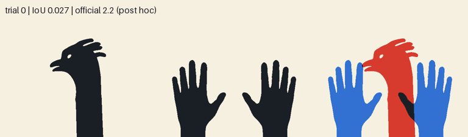
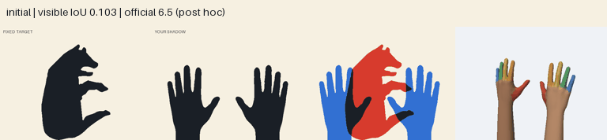

# ShadowBench: dumb rigid-hands IoU baseline

Две **обычные раскрытые руки**, все 46 суставных углов фиксированы на нуле. Алгоритм двигает и поворачивает руки целиком, максимизируя пересечение тени с целевой маской (pixel IoU). Ни названия животного, ни CLIP, ни AdamW, ни изображения из книги он не использует.

Это демонстрация уязвимости **метрики силуэта**: высокий балл может получиться у тени, которая очевидно не похожа на фигуру из книги. Это не доказательство, что всё состязание решено: сильный офлайн-вариант делает больше проб, чем допускает агентный протокол. Также у авторов уже есть baseline с выпуклой оболочкой цели, который набирает больше.

## GIFs

**Offline, 1000 proposals:** GIF содержит старт и равномерную выборку улучшений лучшего IoU. Подпись official score посчитана *после* поиска, не используется для выбора следующего шага.

| Target | Animation |
| --- | --- |
| Bear | [rigid_hands/bursill_bruin/trajectory.gif](results/rigid_iou_1000/bursill_bruin/trajectory.gif) |
| Bunny | [rigid_hands/bursill_bunny/trajectory.gif](results/rigid_iou_1000/bursill_bunny/trajectory.gif) |
| Fowl | [rigid_hands/hilliar_fowl/trajectory.gif](results/rigid_iou_1000/hilliar_fowl/trajectory.gif) |
| All 20 | [results/rigid_iou_1000](results/rigid_iou_1000) |



**Tool-agent, within 100 calls and 32 look images:** GIF содержит *все* изображения, реально полученные через `look`. Подписи с official score добавлены после завершения эпизода.

| Target | Animation |
| --- | --- |
| Bear | [look_only/bursill_bruin/trajectory.gif](results/look_only/bursill_bruin/trajectory.gif) |
| Bunny | [look_only/bursill_bunny/trajectory.gif](results/look_only/bursill_bunny/trajectory.gif) |
| All 20 | [results/look_only](results/look_only) |



Сводные изображения по всем целям: [offline 300](results/rigid_iou_300/contact.png), [offline 1000](results/rigid_iou_1000/contact.png), [tool-agent](results/look_only/contact.png).

## Results on 20 certified targets

| Method | Mean official score | Scope |
| --- | ---: | --- |
| Rest pose | 12.11 | Public task table |
| Rigid hands, 300 proposals | **41.76** | Offline static-pose search, [per-target results](results/rigid_iou_300/summary.csv) |
| Rigid hands, 1000 proposals | **47.02** | Offline static-pose search, animated, [per-target results](results/rigid_iou_1000/summary.csv) |
| Rigid hands, `look` feedback | **29.22** | Legal tool episode, [per-target results](results/look_only/summary.csv) |
| Published blind CMA search | 36.19 | Public task table; about 5954 evaluations per target |
| Published best model per target | 53.06 | Public task table |
| Published target convex hull | 56.91 | Public task table; uses the target mask |

The 300-proposal baseline beats the blind CMA score on 19/20 matched targets (paired mean difference +5.58, bootstrap 95% interval [3.46, 7.83]); it beats the published best model on 0/20. [Comparison CSV](results/rigid_iou_300/published_comparison.csv). The search and agent rows have different budgets, so this is a diagnostic comparison, not a new leaderboard ranking.

At 1000 proposals, the rigid baseline beats the published blind CMA score on 20/20 and the per-target best model on 3/20. The paired mean difference against CMA is +10.84, bootstrap 95% interval [9.40, 12.36]. [Comparison CSV](results/rigid_iou_1000/published_comparison.csv). The saved final poses were independently rerendered and passed the static anatomical gate with identical official scores; see [validation](results/rigid_iou_1000/validation.json). The tool-agent logs passed the [budget audit](results/look_only/audit.json).

## Reproduce

Tested on Linux with Python 3.12. The public [ShadowBench dataset](https://huggingface.co/datasets/perpetual-research/shadowbench) is downloaded at pinned commit `795a17b86e4f24095c0551849909c32482cfe183`; its source and rig are not vendored here.

```bash
python3.12 -m venv .venv
source .venv/bin/activate
python fetch_upstream.py
python -m pip install -e .

python rigid_iou_baseline.py --attempts 1000 --gif --out runs/rigid_iou_1000
python summarize_dumb.py runs/rigid_iou_1000
python compare_published.py runs/rigid_iou_1000

python look_only_baseline.py --out runs/look_only
python make_look_gifs.py runs/look_only
python summarize_dumb.py runs/look_only
python audit_look_only.py runs/look_only
python validate_saved.py runs/rigid_iou_1000
```

`rigid_iou_baseline.py` calls the renderer and static anatomical gate on each candidate. It never queries the official score while searching; it computes that score on the final saved pose. It does **not** enforce the episode's 100-call/32-look limit or continuous motion-path validity. `look_only_baseline.py` uses only the initial observation, tool acceptance text, and `look` images while deciding moves; the final score is read only after `submit`. Its full tool logs and frames are under `results/look_only`.

`compare_published.py` checks exact target revisions before pairing scores. The downloaded `data/tasks/tasks.parquet` supplies published rest, convex-hull, blind-CMA, and best-model values.

## Attribution

[ShadowBench](https://perpetualresearch.si/shadowbench/) by Perpetual Research supplies the simulator, target drawings, task metadata, and the Ultraleap rig. Targets and task metadata are CC BY 4.0; the simulator code is MIT; the rig is Apache 2.0. See [ATTRIBUTION.md](ATTRIBUTION.md). This repository is an independent baseline, not an official ShadowBench submission.
